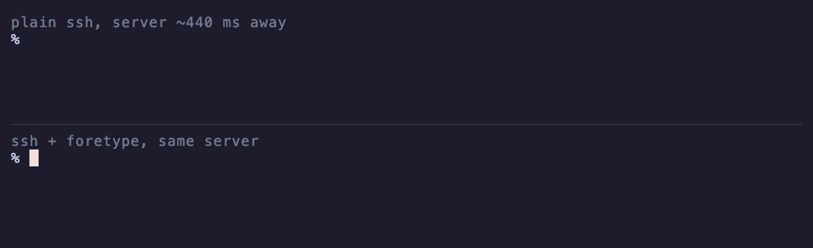

<div align="center">
  <br>
  <picture>
    <source media="(prefers-color-scheme: dark)" srcset="assets/logo-dark.svg">
    
  </picture>
  <br>
  <br>
  <p><b>Type on remote machines at local speed.</b></p>
  <p>A Rust tool that forecasts your typing: each key is drawn before the server echoes it back.</p>
  
  
  <a href="LICENSE"></a>
</div>

<br>

<p align="center">
  
  <br>
  <sub>Top: plain ssh. Bottom: foretype. Same keys at the same moment, to a deliberately laggy server ~440 ms away.</sub>
</p>

```
                       without     with foretype
bash over ssh           160 ms        10 ms
coding agent over ssh   148 ms        11 ms
any laggy console       158 ms        10 ms
```

<sub>A separate measurement, server ~150 ms away. Median time from keypress until the
character is on screen; with foretype that is the locally drawn prediction, and the real
echo still arrives at network speed. Measured with `scripts/latency.py`.</sub>

## Install

```sh
git clone https://github.com/itsfabioroma/foretype && cd foretype
./install.sh
```

To try it without installing, run `cargo build --release`, then
`FORETYPE_SHELL=$SHELL ./target/release/foretype shell`. That runs your shell inside
foretype in the current terminal; `exit` leaves.

## Usage

Open a new terminal tab. That's it. Typing into anything slow now feels instant: ssh,
`kubectl exec`, `docker exec`, a coding agent on a far box. Nothing to install on the
server, and your shell, prompt and config stay the same.

```sh
foretype status             # is this tab boosted?
sudo foretype uninstall     # put your old shell back
```

## How it works

foretype runs your real shell in a pseudo-terminal and forwards every byte unchanged.
It mirrors the screen with [vt100](https://crates.io/crates/vt100) and times how long
each key takes to echo. When the program in front is slower than 30 ms, foretype draws
your keys itself, then checks them against the real echo.

- Only interactive terminals are wrapped. `-c` commands, scripts and pipes get your real
  shell directly.
- Predicts only after the program has echoed on that line, so passwords stay hidden.
- Asks the terminal for its cursor position (`ESC [6n`) before drawing.
- Restores the cursor before forwarding output, so the program's bytes land untouched.
- Takes a prediction back if the echo differs, or if none arrives within about three
  round trips (750 ms at least, 5 s at most).
- Pauses on Enter, editing keys, paste and resize.

## foretype vs mosh

- No server component. mosh needs `mosh-server` on the remote and open UDP ports;
  foretype runs only on your machine, and ssh stays ssh.
- Works on whatever runs in your local terminal: ssh, `kubectl exec`, `docker exec`,
  a serial console, a coding agent.
- mosh roams between networks and survives sleep and dropped connections. foretype
  does neither; if ssh drops, it drops.
- mosh syncs screen state, so it can skip stale output on a slow link. foretype forwards
  every byte, so it hides typing lag, not output lag.

## What it touches

`foretype install` (run by `install.sh` with sudo) does exactly this:

- copies the binary to `/usr/local/bin/foretype` and links `/usr/local/bin/foretype-shell` to it
- saves your current shell in `~/.config/foretype/shell`
- checks that `foretype-shell -c` runs your real shell, then adds it to `/etc/shells`
- sets it as your login shell with `chsh` (`dscl` on macOS if `chsh` fails)

`sudo foretype uninstall` restores your shell and removes all of the above. Root is only
needed for those two commands.

foretype opens no network connections, sends no telemetry, and writes nothing to disk
while running. The one exception is `FORETYPE_LOG=<file>`, an opt-in debug log of
timings and cursor positions, not of what you type. `FORETYPE=off` starts terminals
without it.

It is about 2,900 lines of Rust plus 2,200 lines of tests. Start with
`src/install.rs` (what install changes), `src/shell.rs` (how your real shell is
started) and `src/predict.rs` (what gets drawn).

## Limitations

- Predicts printable ASCII only. Accents, CJK, emoji and IME input pass through
  unpredicted.
- The echo rule is a heuristic. A program that echoes part of a line and then stops
  echoing on that same line, without a newline, would get its next keys predicted.
- Full-screen apps follow the same rule; a change of screen mode, size or row drops the
  prediction.
- Terminals that don't answer cursor queries get plain passthrough.
- If foretype can't start, it runs your real shell directly. If it fails mid-session,
  that tab ends; new tabs start fresh.

## License

Apache-2.0
