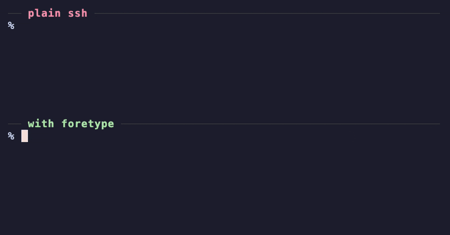

# foretype

**Remote made local.**

foretype is a Rust tool that makes remote typing instant with optimistic echo.



<sub>Same server, same keystrokes. Top: plain ssh. Bottom: with foretype.
Rebuild with `demo/render.sh`.</sub>

```
                       without     with foretype
bash over ssh           160 ms        10 ms
pi (agent) over ssh     148 ms        11 ms
any laggy console       158 ms        10 ms
```

<sub>Median keystroke-to-screen time to a server ~150 ms away, measured with
`scripts/latency.py`.</sub>

## Install

```sh
git clone https://github.com/itsfabioroma/foretype && cd foretype
./install.sh          # builds, then asks for sudo once
```

Open a new terminal tab. That's it: `ssh`, `kubectl exec`, `docker exec`, a cloud
console, a serial port, a coding agent on a remote box: anything you type into that
answers slowly now answers instantly. Your shell, your prompt and your ssh stay exactly
the same.

```sh
foretype status             # is this terminal boosted?
sudo foretype uninstall     # undo everything
```

## How it works

foretype installs itself as the thing your terminal starts, and runs your real shell
inside it. It passes every byte through untouched, and quietly times how long each key
you type takes to come back on screen.

- **Fast programs are left alone.** Your local shell echoes in about a millisecond, so
  foretype never draws anything there. It only measures.
- **Slow ones get boosted.** When whatever is in the foreground takes longer than about
  30 ms to echo, foretype starts showing your keystrokes immediately, exactly as the
  echo will look, and quietly checks them against the real echo when it arrives. It
  doesn't care what the program is called; it only cares that it's slow.
- **Echo is learned first.** Nothing is predicted on a line until the program has
  visibly echoed a key there, so password prompts stay dark.
- **Wrong guesses disappear.** If the screen shows something else, or nothing comes back
  within 750 ms, the prediction is withdrawn.
- **The terminal is checked first.** Before drawing, foretype asks your terminal where
  its cursor is and only draws if the answer matches its own model of the screen.
- **The output is never altered.** foretype only writes between escape sequences,
  outside synchronized updates, behind save/restore cursor, so every byte from the
  program lands exactly where the program put it.

Prediction stops on Enter, editing keys, paste, mouse clicks and resize, and picks up
again with the next echoed character.

## Limits

- It hides typing latency. Command output and an agent's answers still take as long as
  the network and the server do.
- It predicts printable ASCII typed at the end of a line. Mid-line edits, line wrap and
  Unicode input wait for the real echo.
- It can't know whether a program turned echo off mid-line, so such a program could
  briefly show a typed character. Ordinary password prompts never echo, so they never
  get predictions.
- Output is parsed on a background thread while nothing is typed. Heavy output (catting a
  50 MB file) is about 6% slower than without foretype.
- `-c` commands, scripts and non-terminal use run your real shell directly, with no
  foretype process in between.

## Settings

| Variable | Default | |
|---|---|---|
| `FORETYPE` | on | `off` starts terminals without foretype |
| `FORETYPE_TIMEOUT_MS` | `750` | how long an unconfirmed character may stay on screen |
| `FORETYPE_UNDERLINE` | off | `1` underlines characters the remote side has not echoed yet |
| `FORETYPE_LOG` | | write a debug log to this file |

`foretype shell` runs a boosted shell in the current terminal without installing
anything.

## Testing

```sh
cargo test                                          # unit and randomized session tests
python3 scripts/latency.py --host myhost            # typing over ssh, with and without
python3 scripts/latency.py --host myhost --remote 'pi' --ready '(auto)'
python3 scripts/latency.py --connect 'python3 scripts/laggy.py 150'   # no network needed
python3 scripts/fidelity.py --host myhost           # final screens must be identical
```

The scripts drive a private tmux server as the terminal and never submit anything to
the remote side.

## Origin

The prediction engine started as an opt-in remote-typing feature in a fork of
[herdr](https://github.com/herdrdev/herdr). foretype makes it work for every terminal
and every slow program.

## License

Apache-2.0
