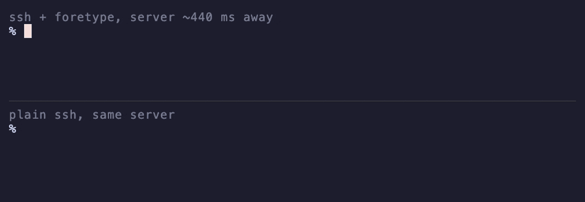

<div align="center">
  <br>
  <picture>
    <source media="(prefers-color-scheme: dark)" srcset="assets/logo-dark.svg">
    
  </picture>
  <br>
  <br>
  <p><b>Remote made local.</b></p>
  <p>foretype is a Rust tool that makes remote typing instant with optimistic echo.</p>
  
  
  <a href="LICENSE"></a>
</div>

<br>

<p align="center">
  
  <br>
  <sub>Top: foretype. Bottom: plain ssh. Same keys at the same moment, to a server ~440 ms away.</sub>
</p>

```
                       without     with foretype
bash over ssh           160 ms        10 ms
pi (agent) over ssh     148 ms        11 ms
any laggy console       158 ms        10 ms
```

<sub>Median time from keypress to screen, server ~150 ms away. Measured with `scripts/latency.py`.</sub>

## Install

```sh
git clone https://github.com/itsfabioroma/foretype && cd foretype
./install.sh
```

## Usage

Open a new terminal tab. That's it. Typing into anything slow now feels instant: ssh,
`kubectl exec`, `docker exec`, a coding agent on a far box. Nothing to install on the
server.

foretype becomes your login shell and runs your real shell inside it, so your prompt and
config stay the same.

```sh
foretype status             # is this tab boosted?
sudo foretype uninstall     # put your old shell back
```

## How it works

foretype becomes your login shell. It runs your real shell in a pseudo-terminal and
forwards every byte both ways, unchanged.

It also feeds the output to a terminal emulator ([vt100](https://crates.io/crates/vt100))
to keep its own copy of the screen, and times how long each key takes to echo. When the
program in front is slower than 30 ms, foretype starts drawing your keys itself:

- It only predicts printable keys at the end of a line where the program has already
  echoed. Password prompts never echo, so they never get predictions.
- Before drawing on a line, it asks the terminal where the cursor is (`ESC [6n`) and
  only draws if that matches its copy.
- It saves the cursor, draws the key in the style the echo will use, and restores the
  cursor before forwarding any output. The program's bytes land where the program put
  them.
- When the echo arrives, it checks it against the guess. If it doesn't match, or nothing
  comes back within 750 ms, it repaints those cells from its copy of the screen.

Enter, editing keys, paste, clicks and resize stop predicting until the next echo. It
hides typing lag, not network lag.

## License

Apache-2.0
